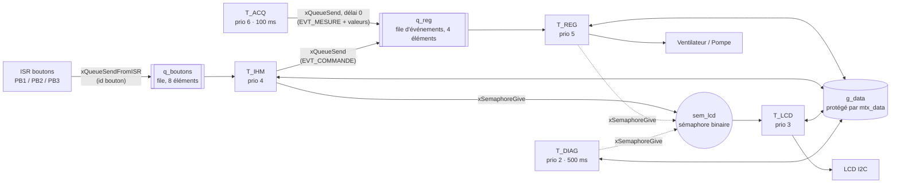
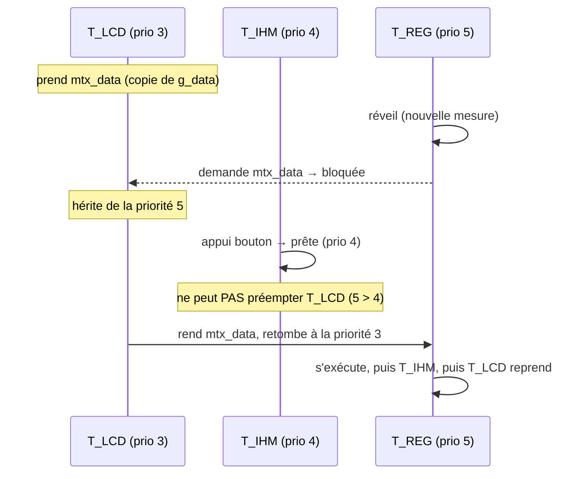

# Conception temps réel – GREENHOUSE V2

*Étape 4 – 04/11/2026 – branche `feature/freertos`, à partir du tag `v2.0-migration`.*
*Références : System_spec_v2 (SR-GH-020 à 032), Analyse_V1_v2, cours « Systèmes Temps Réel » (FISA S3E A5).*

> Toutes les durées d'exécution **C** de ce document sont des **estimations de conception**. Elles seront remplacées par les WCET mesurés à l'étape 6 (SR-GH-029), et l'analyse du §6 sera refaite avec ces valeurs.

---

## 1. Pourquoi un RTOS sur cette serre

La V1 et la migration `v2.0` sont des **super-boucles** : toutes les activités s'enchaînent dans `loop()`, et le temps de réponse de chacune dépend de la durée de toutes les autres. Les défauts relevés en V1 viennent de là :

| Constat V1 / v2.0 | Notion du cours en jeu |
|---|---|
| Fréquence d'échantillonnage dépendant de la durée de l'affichage ; filtre sans constante de temps | Déterminisme temporel |
| Boutons + / − traités seulement toutes les 500 ms, jusqu'à 1 s avant que la nouvelle consigne s'affiche | Temps de réponse, prédictibilité |
| Un redessin du LCD (≈ 35 ms) retarde la régulation | Absence de préemption |
| Appuis mémorisés qui agissent plus tard sur un autre menu | Synchronisation par événements |
| Aucun moyen de prouver le respect d'une échéance | Analyse d'ordonnançabilité (WCET, charge, RTA) |

Le RTOS (FreeRTOS, déjà intégré au core arduino-esp32) apporte un **ordonnanceur préemptif à priorités fixes**. Chaque activité devient une tâche avec sa période, son échéance et sa priorité. La tâche la plus urgente prend le processeur dès qu'elle est prête, même si une tâche moins prioritaire n'a pas fini (par exemple le LCD au milieu d'un redessin).

## 2. Inventaire des activités et contraintes

| Activité | Déclenchement | Période / inter-arrivée min | Échéance D | C estimé | Type TR | Exigences |
|---|---|---|---|---|---|---|
| Acquisition + filtrage | Périodique | T = 100 ms | 100 ms, gigue ≤ 1 ms | 1,0 ms (2 × 16 conversions ADC) | Ferme | SR-021 |
| Régulation (ventilateur, pompe, mise en sécurité) | Nouvelle mesure ou commande manuelle | 100 ms (mesures) + ≥ 200 ms (commandes) | 100 ms | 0,1 ms | Ferme | SR-006/007/022/031 |
| Gestion des boutons | Interruption GPIO | ≥ 200 ms par bouton (anti-rebond) | 100 ms | 0,1 ms | Mou | SR-023/025 |
| Affichage LCD | Périodique + sur demande | 500 ms, ou 100 ms (appuis rapprochés) | 200 ms | 35 ms (redessin complet en I2C) | Mou | SR-023/024 |
| Diagnostic | Périodique | T = 500 ms | 500 ms | 0,1 ms | Ferme (confirmation en 15 s) | SR-011/031 |

**Estimation du C du LCD.** La librairie LCD_I2C envoie chaque caractère en 2 demi-octets, et chaque demi-octet en 2 trames I2C (impulsion Enable). Chaque trame fait environ 20 bits à 100 kHz, soit environ 0,2 ms. Un caractère coûte donc environ 0,85 ms. Un redessin complet compte jusqu'à 32 caractères, plus les positionnements et un `clear` de 1,6 ms : environ 35 ms.

On ne peut pas passer le bus à 400 kHz pour gagner du temps : le PCF8574 est spécifié à 100 kHz maximum. C'est **la tâche la plus longue du système, de loin**.

## 3. Découpage en tâches

Toutes les tâches sont créées par `xTaskCreatePinnedToCore(..., 1)` sur le **cœur 1 (APP_CPU)** (SR-020). La tâche Arduino `loopTask` se supprime après `setup()`.

| Tâche | Rôle | Priorité FreeRTOS | Activation | Pile (à mesurer) |
|---|---|---|---|---|
| `T_ACQ` | Lit les 2 capteurs (sur-échantillonnage), convertit, filtre, publie la mesure | **6** | `vTaskDelayUntil` 100 ms | 3 ko |
| `T_REG` | Applique les lois de commande ou le mode manuel, ou la mise en sécurité ; **seul propriétaire des actionneurs** | **5** | Attente sur `q_reg` (mesure ou commande) | 3 ko |
| `T_IHM` | Traite chaque appui selon la page active (page, consignes, demandes manuelles) | **4** | Attente sur `q_boutons` | 3 ko |
| `T_LCD` | **Seul propriétaire de l'écran** : copie l'état et redessine si changement | **3** | `sem_lcd` ou délai max de 500 ms | 4 ko |
| `T_DIAG` | `error_handler_update`, calcul du code erreur | **2** | `vTaskDelayUntil` 500 ms | 3 ko |

**Principe du gardien (*gatekeeper*).** Chaque ressource matérielle n'a qu'**une seule tâche propriétaire** : l'écran pour `T_LCD`, les actionneurs pour `T_REG`, l'ADC pour `T_ACQ`. Aucune ressource matérielle n'est donc partagée entre tâches, et il n'y a besoin d'aucun mutex sur le bus I2C. La seule ressource réellement partagée est la structure de données `g_data`.

## 4. Attribution des priorités

On applique **Deadline Monotonic** (DM) : plus l'échéance est courte, plus la priorité est haute. Rate Monotonic (RM) en est le cas particulier où D = T. Il ne s'applique pas ici, car l'IHM a une échéance (100 ms) plus courte que son inter-arrivée (200 ms).

1. **`T_ACQ` en tête (6).** C'est la seule tâche qui a une contrainte de **gigue** (≤ 1 ms). Placée en priorité maximale, elle démarre exactement au tick de réveil. Elle ne peut être retardée que par les interruptions, puisqu'elle ne prend aucun mutex et n'est jamais bloquée en envoi (§5).
2. **`T_REG` juste en dessous (5).** Elle s'exécute immédiatement après chaque acquisition. La chaîne capteur → actionneur prend donc environ 1,1 ms, à comparer aux 500 ms exigées par SR-022.
3. **`T_IHM` (4).** Échéance de 100 ms et coût négligeable. Elle passe avant le LCD pour qu'un appui soit pris en compte même pendant un redessin de 35 ms.
4. **`T_LCD` (3), puis `T_DIAG` (2).** Selon DM, l'échéance du LCD (200 ms) est plus courte que celle du diagnostic (500 ms). Le diagnostic peut attendre la fin d'un redessin : son échéance est large et ses délais de confirmation sont de 15 s.

Toutes ces priorités sont supérieures à 1 (`loopTask`, tâche Timer de FreeRTOS) et à 0 (tâche IDLE). Sur le cœur 1, une seule tâche système est plus prioritaire : `ipc1` (priorité 24). Elle n'est sollicitée que par des appels inter-cœurs, qu'on n'utilise pas, et sera tracée à l'étape 6.

**Activation périodique.** On utilise `vTaskDelayUntil()` et non `vTaskDelay()`. La première calcule le réveil à partir de la date de réveil précédente, ce qui empêche toute dérive. La seconde attend une durée à partir de la fin de la tâche, donc la période réelle vaudrait 100 ms + C.

## 5. Communication et synchronisation : sémaphore ou mutex ?

### 5.1 Rappel (cours, diapo 21)

| Critère | Sémaphore | Mutex |
|---|---|---|
| Compteur | Entier dans [0 ; N] | Binaire |
| Propriétaire | Aucun | La tâche qui l'a pris |
| Libération | N'importe quelle tâche (ou une interruption) | La tâche propriétaire uniquement |
| Usage | Ressources multiples, **synchronisation** | **Protection d'une section critique** |
| Spécifique FreeRTOS | Peut être donné depuis une interruption (`...FromISR`) | **Héritage de priorité**, interdit en interruption |

### 5.2 Choix retenus, un par besoin

| Besoin | Mécanisme retenu | Justification | Pourquoi pas l'alternative |
|---|---|---|---|
| Protéger `g_data` (mesures, consignes, page, demandes manuelles, états, code erreur), lue et écrite par 4 tâches | **Mutex `mtx_data`** | C'est une section critique : une seule tâche à la fois. La tâche qui prend le mutex le rend. L'**héritage de priorité** borne l'inversion de priorité (§5.3). | Un sémaphore binaire n'a pas d'héritage de priorité : l'inversion de priorité serait non bornée. Il n'a pas non plus de propriétaire, donc une erreur de libération ne serait pas détectable. |
| Demander un redessin immédiat après un appui, un changement d'actionneur ou de diagnostic (`T_IHM`, `T_REG`, `T_DIAG` → `T_LCD`) | **Sémaphore binaire `sem_lcd`** | Pure synchronisation : la tâche qui donne n'est pas celle qui prend, et trois tâches différentes peuvent donner. Plusieurs demandes avant le redessin se fusionnent en une seule. | Un mutex doit être libéré par la tâche qui l'a pris : impossible ici. |
| Transmettre un appui de l'interruption à la tâche | **File `q_boutons`** (identifiant du bouton) | Transporte *quel* bouton a été appuyé, sans perte grâce à l'ordre FIFO. Utilisable depuis une interruption (`xQueueSendFromISR`). `T_IHM` traite l'appui immédiatement dans le contexte de la page active, ce qui supprime le bug des appuis mémorisés (SR-025). | Un sémaphore binaire ne dit pas quel bouton a été appuyé et perd les appuis rapprochés. Un mutex est interdit en interruption. |
| Déclencher la régulation : nouvelle mesure (`T_ACQ`) ou commande manuelle (`T_IHM`) | **File d'événements `q_reg`** (4 éléments, type `reg_event_t` = {EVT_MESURE + valeurs, EVT_COMMANDE}) | Une seule file réveille `T_REG` pour les deux causes et transporte des données structurées (la mesure). `T_REG` passe juste après `T_ACQ` et avant `T_IHM` : elle vide la file dès qu'un événement arrive, donc la file ne se remplit jamais en pratique. `T_ACQ` envoie avec un délai de 0 : elle n'est **jamais bloquée** et ne prend jamais `mtx_data`, ce qui garantit sa gigue. Une file pleine serait comptée comme anomalie par `rt_trace`. | Un mutex obligerait `T_ACQ` à attendre si `T_LCD` détient `g_data`. Une boîte aux lettres (`xQueueOverwrite`) ne transmettrait que la mesure, pas les commandes manuelles : la bascule d'un actionneur attendrait alors jusqu'à 100 ms la mesure suivante. |
| Accès au LCD / I2C et aux actionneurs | **Aucun objet de synchronisation** (gardien, §3) | Une seule tâche accède à chaque ressource. | Un mutex I2C serait tenu pendant 35 ms et provoquerait des blocages longs. |

**Sémaphore à compteur.** Il ne serait justifié que pour un **lot de N ressources identiques** (par exemple N tampons d'émission). Il n'y a pas de tel lot dans la serre, mais il faut savoir l'expliquer à l'oral.

**Règle de codage pour `mtx_data`.** Sous mutex, on ne fait **que copier** des données (quelques µs) : on ne fait jamais d'I2C, d'appel ADC ou de `Serial`. `T_LCD` copie un instantané de `g_data`, rend le mutex, *puis* dessine. L'accès est encapsulé dans un module `shared_data` (`shared_data_get_*` / `shared_data_set_*`), qui ne prend le mutex qu'avec un délai maximal (`pdMS_TO_TICKS(10)`).

### 5.3 Inversion de priorité : le scénario concret

Sans héritage, c'est-à-dire avec un sémaphore binaire, `T_IHM` préempterait `T_LCD` pendant que `T_REG` attend. Une tâche de priorité intermédiaire retarderait alors la plus prioritaire pour une durée non bornée. C'est le bug historique de **Mars Pathfinder (1997)**, provoqué par un mutex VxWorks dont l'héritage de priorité était désactivé. Avec le mutex, le blocage de `T_REG` est borné par la plus longue section critique d'une tâche moins prioritaire : **B ≈ 10 µs**.

## 6. Analyse d'ordonnançabilité (valeurs estimées)

### 6.1 Charge processeur

Pour les tâches sporadiques, on prend leur inter-arrivée minimale comme période. Pour `T_LCD`, on prend le pire cas de 100 ms, soit 10 appuis par seconde. Le sémaphore binaire fusionne les demandes au-delà.

| Tâche | C (ms) | T (ms) | U = C / T |
|---|---|---|---|
| T_ACQ | 1,0 | 100 | 1,0 % |
| T_REG | 0,1 | 100 (mesures) + 200 (commandes) | 0,15 % |
| T_IHM | 0,1 | 200 | 0,05 % |
| T_LCD | 35 | 100 | 35 % |
| T_DIAG | 0,1 | 500 | 0,02 % |
| **Total** | | | **≈ 36,2 %** |

La borne de Liu & Layland pour n = 5 tâches vaut 5 × (2^(1/5) − 1) ≈ **74,3 %**. Celle de SR-GH-028, valable pour n → ∞, vaut ln 2 ≈ **69 %**. U ≈ 36 % est en dessous des deux : le système est **ordonnançable** avec environ 33 points de marge. Cette condition est suffisante mais pas nécessaire, d'où l'analyse des temps de réponse ci-dessous.

### 6.2 Temps de réponse pire cas (RTA)

R_i = C_i + B_i + Σ_{j ∈ hp(i)} ⌈R_i / T_j⌉ · C_j, avec hp(i) l'ensemble des tâches plus prioritaires que i. On itère jusqu'à ce que R_i ne change plus.

| Tâche | Calcul | R_i | D_i | Marge |
|---|---|---|---|---|
| T_ACQ | 1,0 + 0,01 | **1,01 ms** | 100 ms | 99 % |
| T_REG | 0,1 + 0,01 + 1,0 | **1,11 ms** | 100 ms | 99 % |
| T_IHM | 0,1 + 0,01 + 1,0 + 0,1 | **1,21 ms** | 100 ms | 99 % |
| T_LCD | 35 + 0,01 + 1,1 + 0,1 | **36,2 ms** | 200 ms | 82 % |
| T_DIAG | 0,1 + 1,1 + 0,1 + 35 | **36,3 ms** | 500 ms | 93 % |

Toutes les marges dépassent les 20 % exigés par SR-GH-029. Pour SR-GH-023 : appui → prise en compte ≤ R_IHM ≈ 1,2 ms (< 100 ms). Appui → bascule d'un actionneur en mode manuel ≈ R_IHM + C_REG ≈ 1,3 ms, car `T_REG` préempte `T_IHM` dès l'envoi dans `q_reg`. Appui → écran à jour ≤ R_IHM + R_LCD ≈ 37 ms (< 200 ms). En V1, ces durées montaient jusqu'à environ 1 s.

**Hors modèle, à mesurer à l'étape 6.** Le tick FreeRTOS (1 kHz), les interruptions I2C et GPIO, la tâche `ipc1`, et les défauts de cache flash qui allongent C de façon irrégulière : c'est la raison de la marge de 20 %.

### 6.3 Chronogramme typique (début d'hyperpériode)

L'hyperpériode, plus petit multiple commun de 100, 200 et 500, vaut 1 s. Exemple : un appui sur PB2 à t = 30 ms, alors que le LCD redessine.

```mermaid
gantt
    title Cœur 1 – exemple sur 0-140 ms (durées estimées)
    dateFormat x
    axisFormat %L ms
    section T_ACQ (6)
    acquisition          :a1, 0, 1ms
    acquisition          :a2, 100, 1ms
    section T_REG (5)
    régulation           :r1, 1, 1ms
    régulation           :r2, 101, 1ms
    section T_IHM (4)
    appui PB2            :crit, i1, 30, 1ms
    section T_LCD (3)
    redessin (début)     :l1, 2, 28ms
    préempté par T_IHM   :done, 30, 1ms
    fin + nouveau redessin :l2, 31, 42ms
    section T_DIAG (2)
    diagnostic (prêt depuis 0 ms) :d1, 73, 1ms
```

## 7. Sûreté de fonctionnement

- **Chien de garde (SR-030).** Chaque tâche s'enregistre auprès du Task Watchdog Timer d'ESP-IDF (`esp_task_wdt_add(NULL)`, délai de 5 s) et le rafraîchit à chaque cycle. Les tâches réveillées par événement (`T_REG`, `T_IHM`, `T_LCD`) attendent avec un délai maximal (respectivement 500 ms, 1 s et 500 ms), jamais `portMAX_DELAY`. Elles se réveillent donc toujours à temps pour rafraîchir le chien de garde. Si une tâche est bloquée plus de 5 s, le système redémarre.
- **Mise en sécurité (SR-031).** `T_REG` lit le code erreur dans `g_data`. Sur défaut pompe, la pompe est arrêtée. Sur sonde de température hors service, le ventilateur est forcé ON. Cette logique prime sur le mode automatique et le mode manuel.
- **Piles.** Les valeurs du §3 sont confortables. Elles seront ajustées à partir de `uxTaskGetStackHighWaterMark()` à l'étape 6. Le débordement de pile est détecté par FreeRTOS (option active dans le core).
- **Interruptions boutons.** Elles sont courtes, placées en RAM interne (`IRAM_ATTR`), avec un anti-rebond **par bouton**. L'appui est détecté **à l'enfoncement**, et non plus au relâchement comme en V1. L'interruption est armée sur les deux fronts (`CHANGE`) : chaque front, y compris un rebond, met à jour la date du dernier front. Un appui n'est validé que si la broche est à l'état bas, si la ligne était stable depuis au moins 30 ms, et si 200 ms au moins se sont écoulées depuis le dernier appui validé. Ce test de stabilité rejette aussi les fronts descendants parasites qui apparaissent au relâchement. **Bouton maintenu enfoncé** : la ligne reste basse et ne produit plus aucun front, donc plus aucune interruption. Un appui donne ainsi un seul événement, sans répétition ni surcharge processeur. Une interruption sur niveau (`ONLOW`) aurait au contraire saturé le processeur tant que le bouton reste enfoncé. L'interruption appelle `portYIELD_FROM_ISR` si `T_IHM` doit préempter la tâche en cours.

## 8. Instrumentation prévue pour l'étape 6 (WCET)

Un module `rt_trace`, activé par `#define RT_TRACE 1` et vide sinon (SR-029) :
- horodatage d'entrée et de sortie de chaque tâche avec `esp_timer_get_time()` (résolution 1 µs), calcul de C min, max et moyen sur N ≥ 1000 activations ;
- mesure de la gigue d'activation de `T_ACQ` et de la latence appui → prise en compte ;
- possibilité de faire basculer un GPIO libre à l'entrée et à la sortie d'une tâche, pour une mesure à l'oscilloscope indépendante du logiciel ;
- impression des statistiques par `T_DIAG` (priorité la plus basse), pour ne pas perturber les mesures.

## 9. Organisation du code (étape 5)

| Fichier | Rôle | Statut |
|---|---|---|
| `greenhv2.ino` | `setup()` crée les objets RTOS et les tâches (cœur 1) ; corps des 5 tâches, qui ne font qu'appeler les composants | Modifié |
| `shared_data.cpp/.h` | Structure `g_data` + mutex + accès get/set | **Nouveau** |
| `buttons.cpp/.h` | Interruptions sur les deux fronts, anti-rebond par bouton, `q_boutons` | **Nouveau** (extrait du .ino) |
| `regulation.cpp/.h` | Lois TOR et PWM, mode manuel, mise en sécurité | **Nouveau** (extrait du .ino) |
| `rt_trace.cpp/.h` | Instrumentation WCET | **Nouveau** |
| `capteurs`, `filter`, `lcd`, `lcd_page_manager`, `motor_driver_*`, `error_handler` | Inchangés (éventuellement de petites adaptations) | Réutilisés |

## 10. Ouverture : et avec les deux cœurs ?

L'ESP32 tourne sous un FreeRTOS SMP, avec un ordonnanceur par cœur et des tâches épinglées ou libres. Répartition naturelle **partitionnée** :

| Cœur 0 (PRO_CPU) | Cœur 1 (APP_CPU) |
|---|---|
| `T_LCD`, `T_DIAG` (+ Wi-Fi / MQTT pour une V3 IoT) | `T_ACQ`, `T_REG`, `T_IHM` |

**Ce que ça apporterait :**
- **Isolation temporelle** : le redessin de 35 ms ne pourrait plus interférer avec la chaîne de contrôle. Sur le cœur 1, R_DIAG et la charge tomberaient à environ 1 %.
- **Parallélisme réel**, et de la place pour une pile réseau sans remettre en cause les échéances de régulation.
- **Une analyse qui reste simple** : en ordonnancement partitionné, on applique RM/DM et Liu & Layland à chaque cœur séparément (U₀ ≈ 35 %, U₁ ≈ 1,2 %).

**Ce que ça coûterait :**
- Des sections critiques inter-cœurs : `taskENTER_CRITICAL` avec un verrou à attente active (`portMUX`), car masquer les interruptions sur un seul cœur ne suffit plus. Le mutex FreeRTOS reste valable entre cœurs.
- Des interférences matérielles entre cœurs (bus mémoire et cache flash partagés), qui dégradent la prédictibilité : le WCET mesuré sur un cœur ne vaut plus forcément quand l'autre cœur est chargé.
- Une mise au point plus difficile : traces entrelacées, non-reproductibilité.
- Un ordonnancement *global* (tâches non épinglées) serait plus souple, mais beaucoup plus difficile à analyser : les bornes de type Liu & Layland ne s'y appliquent pas.

Pour cette serre, un seul cœur suffit largement (U ≈ 36 %). Le bi-cœur ne deviendrait pertinent qu'avec une connectivité réseau.

## 11. Décisions (validées)

1. **Actionneurs pilotés par `T_REG` seule, y compris en mode manuel** (validé le 04/11/2026). `T_IHM` enregistre la demande et envoie `EVT_COMMANDE` dans `q_reg`. La bascule est effective en environ 1,3 ms.
2. **Boutons détectés à l'appui** au lieu du relâchement en V1 : interruption sur les deux fronts et test de stabilité. Un bouton maintenu enfoncé ne produit qu'un seul événement (validé le 04/11/2026).
3. **Bus I2C maintenu à 100 kHz** (limite du PCF8574, validé le 04/11/2026).
